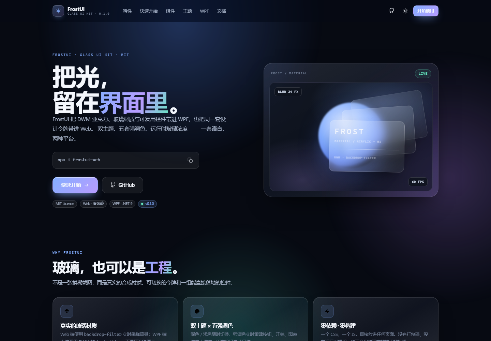
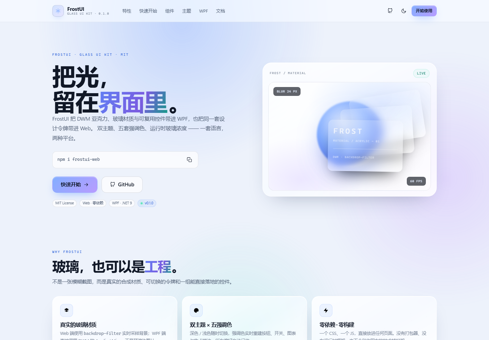

# FrostUI

[](https://www.nuget.org/packages/FrostUI)
[](https://www.npmjs.com/package/frostui-web)
[](LICENSE)

> **把光，留在界面里。** 一套毛玻璃 UI 框架：WPF 端真实 DWM 亚克力，Web 端零依赖玻璃组件库。
> 官网 / 组件演示：<https://teaboss-developer.github.io/FrostUI/>



## 两个版本，一套设计语言

| | FrostUI for WPF | FrostUI for the Web |
| --- | --- | --- |
| 形态 | NuGet 类库 + 示例应用 + 可视化设计器 | 单个 CSS + 单个 JS，无构建 |
| 材质 | DWM Acrylic / Mica / Mica Alt / Blur | `backdrop-filter` 实时模糊 + 回退表面 |
| 主题 | 深 / 浅 + 运行时强调色 | `data-f-theme` + `data-f-accent` |
| 依赖 | .NET 9，无第三方包 | 0 依赖 |
| 适合 | Windows 桌面应用 | 官网、后台、个人主页、文档站 |

---

## FrostUI for the Web



### 安装

```bash
npm install frostui-web
```

或者直接下载 `web/frostui.css` 与 `web/frostui.js`：

```html
<link rel="stylesheet" href="web/frostui.css">
<script src="web/frostui.js" defer></script>
```

### 30 秒上手

```html
<html lang="zh-CN" data-f-theme="dark" data-f-accent="azure">
<body class="f-page">

  <button class="f-btn f-btn--primary">开始使用</button>

  <div class="f-card">
    <div class="f-card__head">
      <h3 class="f-card__title">玻璃卡片</h3>
    </div>
    <p class="f-muted">内容放在这里。</p>
  </div>

</body>
</html>
```

```js
FrostUI.setTheme('light');     // dark | light | auto
FrostUI.setAccent('mint');     // azure | mint | violet | sakura | amber
FrostUI.setBlur(32);           // 0–48px
FrostUI.toast('已保存');
```

- 完整类名、JS API 与主题令牌：[web/README.md](web/README.md)
- 在线组件演示与实时调色：[官网](https://teaboss-developer.github.io/FrostUI/)
- 组件：卡片、按钮、输入框、开关、滑杆、分段选择、标签、状态点、头像、统计块、导航、Toast、代码块

---

## FrostUI for WPF


### 安装

```powershell
dotnet add package FrostUI
```

或从源码打包（离线 / 内网）：

```powershell
dotnet pack src/FrostUI/FrostUI.csproj -c Release -o artifacts
dotnet add package FrostUI --source artifacts
```

### 30 秒接入

```xml
<!-- App.xaml -->
<ResourceDictionary Source="pack://application:,,,/FrostUI;component/Themes/Controls.xaml" />
```

```xml
<frost:FrostWindow
    xmlns:frost="clr-namespace:FrostUI.Controls;assembly=FrostUI"
    Style="{StaticResource FrostWindowStyle}"
    Backdrop="Acrylic"
    TintOpacity="0.28"
    Title="My App" Width="1200" Height="800">
  <frost:GlassCard Padding="24">
    <!-- 你的内容 -->
  </frost:GlassCard>
</frost:FrostWindow>
```

```csharp
using FrostUI.Theme;

ThemeManager.Initialize();
ThemeManager.SetTheme(FrostThemeMode.Dark);
ThemeManager.SetAccent(Color.FromRgb(0x84, 0xAE, 0xFF));
```

### 包含什么

- `FrostWindow`：无边框圆角、DWM 材质、深浅标题栏、拖动与最大化
- `GlassCard`：渐变玻璃、高光描边、噪点、环境阴影
- `GlassToggleSwitch`、`ProgressRing`、`Sparkline`、`FrostMessageBox`
- 按钮 / 输入框 / 滑杆 / 进度条 / 导航 / 滚动条等完整控件模板
- `FrostUI.Demo` 示例应用与 `FrostUI.Designer` 可视化设计器

> `PlayerTemplates/` 是导出功能使用的构建产物（约 260 MB），不纳入 Git；首次使用导出前运行 `designer/build-player-templates.ps1` 重新生成。

更多细节见 [WPF 文档](docs/wpf.md)。

---

## 仓库结构

```
FrostUI/
├─ index.html              # 官网 / 组件演示（GitHub Pages）
├─ web/                    # Web 组件库（CSS + JS + npm 包信息）
├─ site/                   # 官网布局与交互
├─ src/FrostUI/            # WPF 类库
├─ samples/FrostUI.Demo/   # WPF 示例应用
├─ designer/               # 可视化设计器
├─ player/                 # 设计稿运行器
├─ docs/                   # 架构说明、WPF 文档、说明书
├─ screenshots/            # 产品截图
└─ FrostUI.sln
```

## 本地开发

```powershell
# WPF
dotnet build FrostUI.sln -c Release
dotnet run --project samples/FrostUI.Demo/FrostUI.Demo.csproj

# Web 官网（任选一个静态服务器）
python -m http.server 8080
# 打开 http://localhost:8080
```

## 文档

- [Web 组件文档](web/README.md)
- [WPF 文档](docs/wpf.md)
- [架构说明](docs/architecture.md)
- [设计器手册](designer/README.md)
- [零基础说明书](docs/FrostUI-Designer-零基础说明书.docx)

## 发布

WPF 包使用 nuget.org **Trusted Publishing**（OIDC，无需保存 API Key）：

- Package owner：`TeaBoss`
- Repository：`TeaBoss-Developer/FrostUI`
- Workflow：`publish-nuget.yml`

在 GitHub Actions 里手动运行 **Publish NuGet**，或推送 `v*` tag 即可自动发布；工作流会用 `NuGet/login@v1` 换取一次性密钥。

需要长期密钥的备用方式：

```powershell
$env:NUGET_API_KEY = "..."        # https://www.nuget.org/account/apikeys
.\scripts\publish-nuget.ps1
```

Web 包发布到 npm（包名 `frostui-web`）：

```powershell
cd web; npm publish
```

## License

MIT © FrostUI contributors
