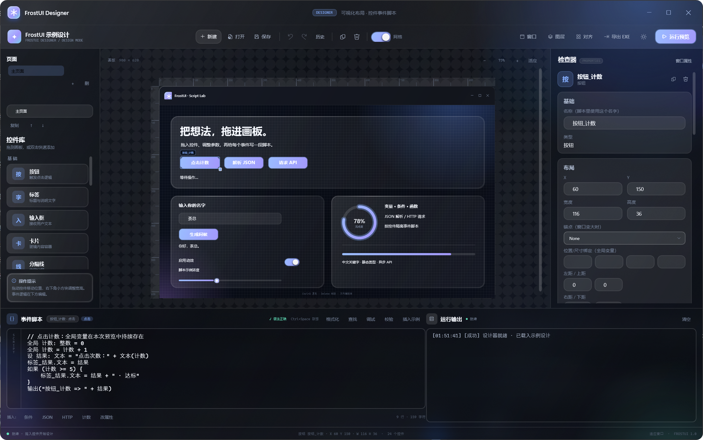
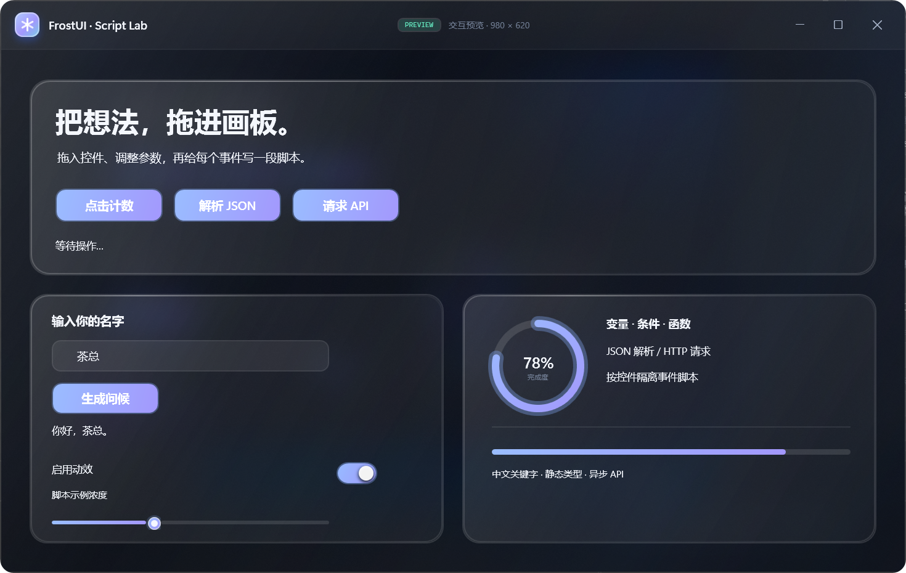
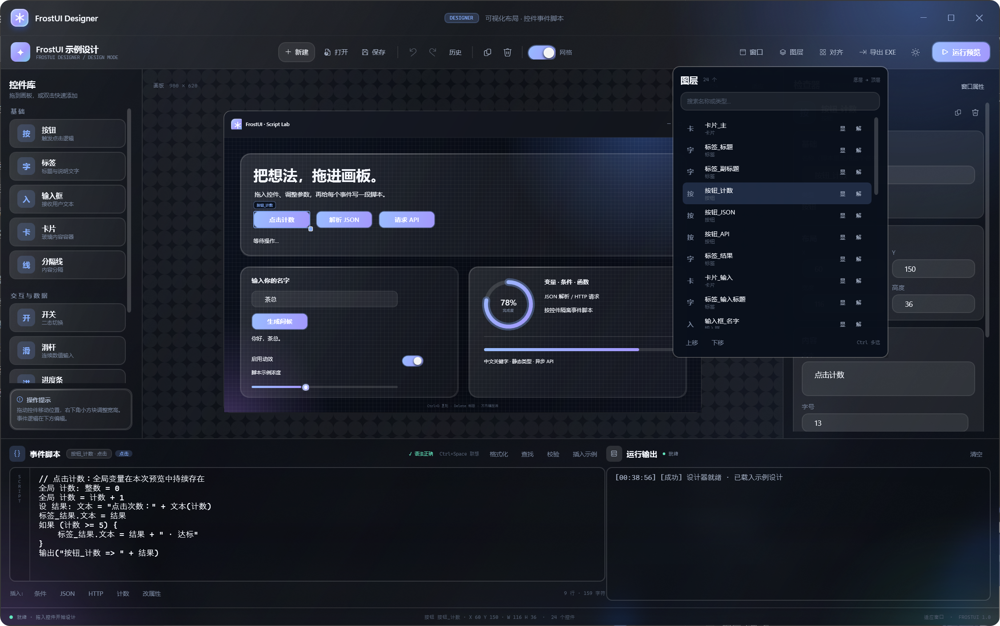

# FrostUI Designer

> FrostUI 的可视化 UI 设计器：拖控件、改属性、按控件编写事件脚本，然后直接运行成真正的 FrostUI 毛玻璃窗口。



| 交互预览 | 真实 FrostUI 窗口 |
| --- | --- |
|  | 预览窗口中的按钮、开关、输入框、JSON、HTTP 都由设计数据实时构建。 |

## 运行

```powershell
cd frost-ui
dotnet run --project designer/FrostUI.Designer/FrostUI.Designer.csproj
```

Release：

```powershell
dotnet build designer/FrostUI.Designer/FrostUI.Designer.csproj -c Release
```

## 目标

这个项目不是“图片拼贴器”。设计数据（窗口、控件、位置、尺寸、事件脚本）会序列化成 JSON，再由 `PreviewWindow` **实时构建成真实的 FrostUI 控件**。按钮点击、开关切换、输入框修改、滑杆拖动都会进入脚本引擎。

设计器本身也是一个 `FrostWindow`，启动方式与普通 FrostUI 应用完全一致。

## 五分钟工作流

1. 左侧 **控件库** 里把控件拖到画板，或双击工具快速添加。
2. 单击控件选中；`Ctrl/Shift` 点选多选，或在空白处拖出框选；右侧检查器修改主选控件参数（含字号、字体、粗体）。
3. 用顶部 **对齐** 做左/中/右、上/中/下和等距分布；拖动时会出现智能参考线并自动吸附。
4. 用 **图层** 面板搜索、显示/隐藏、锁定、调整 z-order。
5. 点击画板空白处或“窗口属性”，修改窗口标题、宽高、描述、材质和亚克力浓度。
6. 在底部 **事件脚本** 中为当前控件的 `点击` / `切换` / `文本改变` / `值改变` 写逻辑。
7. 点右上角 **运行预览**（或 `F5`），预览窗口会按当前设计创建真实的 FrostUI 界面。
8. 点右上角 **导出 EXE**，选择文件夹，得到可直接运行的 release。
9. 用 **保存** 导出 `.frostui.json`；下次用 **打开** 继续编辑。

### 画板操作

- 拖动控件本体移动位置；自动吸附 8px 网格。
- 选中控件后拖动右下角的小方块调整宽高。
- `Ctrl+D` 复制，`Delete` 删除，方向键微调，`Shift + 方向键` 一次 8px。
- 单击选中；`Ctrl/Shift` 点选追加/取消；在空白处拖拽框选。
- 多选后顶部 **对齐** 可用：左右/水平居中、上下/垂直居中、横向/纵向等距。
- 拖动多个控件时整体移动，锁定控件不会被拖动。
- 画布顶部 `− / 百分比 / + / 适应` 控制缩放；`Ctrl+滚轮` 缩放，中键拖动画布平移，滚动条也可平移。
- `Ctrl+Z` 撤销，`Ctrl+Y` / `Ctrl+Shift+Z` 重做；顶部 **历史** 可以跳到任意快照。
- `Ctrl+S` 保存，`Ctrl+O` 打开，`Ctrl+N` 新建，`F5` 预览。
- 脚本编辑器里 `Ctrl+Space` 主动打开联想；`Enter` / `Tab` 接受，`↑` / `↓` 选择，`Esc` 关闭。
- `F9` 在当前行切换断点标记；断点会显示为编辑器左侧红点。
- 点击“调试”打开调试窗口：在断点/第一步暂停，可查看变量、调用栈，使用“继续 / 单步 / 停止”。
- 调试窗口可编辑断点规格：`5:计数 > 3` 为条件断点，`7:log` 为日志断点；日志断点记录变量后自动继续。
- `Ctrl+F` 查找，`Ctrl+H` 查找/替换，`Ctrl+/` 切换选中行注释；支持“全部替换”。
- `Ctrl+K` 打开命令面板，可搜索并执行新建、保存、预览、导出、对齐、图层、格式化、添加控件等操作。
- 脚本编辑区“参考”打开独立参考窗口：关键字、类型、函数、JSON/HTTP、页面/项目 API、控件属性/种类/事件；支持搜索、分类、置顶和双击插入签名。
- 画板空白处点击或 `Esc` 回到窗口属性。

### 编辑安全与图层

- **自动保存**：有未保存修改时每 9 秒写入 `%LOCALAPPDATA%\FrostUI.Designer\autosave.frostui.json`。
- **恢复**：上次异常退出后会提示恢复自动保存；选择“否”会删除它。
- **历史**：最多保留 80 个完整设计快照，可撤销/重做，也可以点击历史条目直接跳转。
- **图层**：显示/隐藏、锁定/解锁、上移/下移；搜索按名称或类型过滤。锁定控件仍可从图层选中，但不能在画板上拖动或缩放。
- **可见性**：隐藏控件不再响应画板点击，只能从图层重新选中。
- **对齐与参考线**：拖动时对其它控件的边缘、中心以及窗口边缘/中心做 6px 内吸附，并显示高亮参考线。
- **自定义网格**：窗口属性里的“网格大小”支持 2–64；网格绘制和 8px/自定义吸附同步。
- **内容随窗口缩放**：开启后预览/导出 Player 调整大小时按比例整体适配；关闭时保持固定像素布局。
- **控件锚点**：窗口属性开启“启用控件锚点”后，控件可设 `Left / Top / Right / Bottom / RightBottom / CenterX / CenterY`，以及 `StretchHorizontal / StretchVertical / StretchAll / StretchLeftRight / StretchTopBottom / Fill`；四向边距（左/上/右/下）会参与锚点和拉伸，拉伸受最小/最大宽高约束。
- **响应式断点**：窗口属性填写 `0:fixed,720:anchor,1080:scale`，预览/Player 按窗口宽度跨越断点时自动切换固定、锚点或整体缩放布局。
- **容器布局**：Stack / Grid / Dock / Scroll；子控件在检查器填写“父容器”，预览/Player 中按容器规则重排。Stack 支持纵横堆叠与间距；Grid 支持行列/跨行跨列；Dock 支持上下左右停靠；Scroll 提供可滚动画布。
- **表单控件**：复选框、单选框、下拉框、密码框、数字框、多行文本、日期、搜索框；支持 `.选中` / `.选中项` / `.选项` / `.值` / `.最小值` / `.最大值` / `.步长` / `.日期` 等脚本属性。示例设计：`designer/samples/form-controls.frostui.json`。
- **布局控件**：标签页（`TabIndex` 分配子控件）、折叠面板（展开/收起）、左右分栏（`PaneIndex` 分配左右栏 + 拖动分隔条）；示例设计：`designer/samples/layout-controls.frostui.json`。
- **菜单与通知**：横向菜单（`菜单点击` 事件）、通知条（Info/Success/Warning/Error + 关闭）；任意控件可设置“悬停提示”和“右键菜单（每行一项）”。
- **数据控件**：数据表格（列 + `|` 分隔行，表头排序、双击单元格编辑）、树形列表（两空格缩进）、重复卡片（`标题|副标题`）、柱状 / 折线 / 饼图（`标签:数值`，悬停显示数值）；支持 `.选中项`、`.表格列`、`.图表类型`、`.可编辑`、`.可排序`。示例设计：`designer/samples/data-controls.frostui.json`。
- **主题色**：顶部调色板按钮打开主题色窗口；支持预设、RGB、十六进制、实时预览和取消恢复。主题色保存到 `design.frostui.json` 的 `accentColor`，预览和导出的 Player 会应用。
- **控件主题色**：检查器“控件主题色”可为选中控件设置独立强调色；留空跟随全局主题。预览 / Player 中按钮、选中状态、进度和描边会使用控件局部主题色。
- **多页面 / 多窗口**：左侧页面栏可新建/删除/复制/上移/下移页面，每个页面有独立控件、脚本、参考线、页面类型和可选的标题/宽高/材质；控件导航可切换页面、打开独立窗口、打开模态窗口或关闭当前窗口。脚本支持 `页面.切换`、`页面.打开窗口`、`页面.打开弹窗`、`页面.关闭`、`页面.传参`、`页面.参数`、`页面.设置结果`、`页面.结果`；也支持用页面名作别名，例如 `主页面.打开窗口(...)`。切换页面会执行目标页面的“启动”脚本。
- **项目共享数据**：脚本 API `项目.设置("键", 值)` / `项目.获取("键")`，同一工程的所有窗口/弹窗共享；数据持久化到 `%LOCALAPPDATA%\FrostUI.Designer\project-data`。
- **内嵌遮罩弹窗**：页面 `DialogDisplay=Overlay` 时，弹窗以当前窗口内的遮罩层打开，支持关闭、页面脚本和返回结果；`Window` 模式仍打开独立模态窗口。
- **页面类型导航**：控件 `Open` 动作或 `页面.打开("页面")` 会按页面类型自动切换页面 / 独立窗口 / 弹窗。
- **组件 / 片段库**：把选中控件保存为本地组件，支持搜索、重命名、删除、复制、导入、导出、打开目录和统计，双击插入独立副本；脚本、图片、字体等随组件保存。组件库目录改为 `<当前运行目录>\components`，不再写入 `%LOCALAPPDATA%`。
- **组件实例 / 变体**：可插入“实例”（记录来源、变体和实例 ID），从组件库更新后点“刷新实例”重载全部控件；“分离实例”保留控件并断开来源。支持 `基础名@变体` 组件文件；组件文件保存时会自动刷新引用实例。
- **实例覆盖**：实例控件可“记录覆盖”保存文本/宽高/字号/粗体/圆角/透明度，刷新和自动更新时保留这些实例级修改；“清覆盖”恢复组件源值。
- **样式 / 设计令牌**：把字体、字号、粗体、圆角、透明度保存为命名令牌；控件可选择令牌，更新令牌会同步所有引用它的控件。
- **标尺**：画板顶部和左侧显示随缩放更新的像素刻度。
- **参考线**：从顶部标尺向下拖出水平参考线，从左侧标尺向右拖出垂直参考线；已有参考线可拖动重新定位，右键删除，拖动控件时会吸附到参考线；参考线保存进设计文件并参与撤销/重做。



## 控件

| 控件 | 说明 | 事件 |
| --- | --- | --- |
| 按钮 | 主要操作 | 点击 |
| 标签 | 标题 / 说明 | 点击 |
| 输入框 | 文本输入 | 文本改变 |
| 卡片 | 玻璃内容容器 | 点击 |
| 分隔线 | 内容分隔 | 点击 |
| 开关 | 二态切换 | 切换 |
| 滑杆 | 0–100 连续值 | 值改变 |
| 进度条 | 线性进度 | 点击 |
| 环形进度 | 环形百分比 | 点击 |
| 图片 | 本地 PNG/JPG/BMP/GIF | 点击 |

窗口本身有 `启动` 事件。

## 类易语言脚本

脚本按控件、按事件分开保存。中文关键字和英文别名都可以使用。

### 自动联想

脚本编辑器不是普通 TextBox。输入时会根据当前源码和设计器中的真实控件给出 IDE 式提示：

- 根上下文：关键字、当前脚本里的变量、画板上的控件、`输出/提示/JSON/HTTP` 等内建名、类型名。
- 控件后输入 `.`：显示该控件的全部可读写属性，例如 `按钮_计数.` → `文本 / 宽 / 高 / 可见 / 启用 …`。
- `JSON.`：`解析 / 取值 / 文本`；`HTTP.`：`获取 / 获取JSON / 提交JSON`。
- `设 x: ` 或 `全局 x: ` 后：显示 `整数 / 小数 / 文本 / 逻辑 / JSON / 任意`。
- 字符串和注释内部不会弹出联想，避免误插。
- `Ctrl+Space` 可以在任何位置强制打开；`↑/↓` 移动、`Enter/Tab` 接受、`Esc` 关闭，也可以用鼠标双击插入。
- 函数项会插入 `解析()` 这样的括号，并把光标放在括号内。
- 编辑器头部有实时语法检查：正确时显示 `✓ 语法正确`，错误时直接显示解析器的行号和原因（红色文字，悬停可看完整信息）。
- 点击头部诊断文字会打开 **脚本问题列表**，列出语法错误、未定义控件/对象、错误控件属性和未知函数；双击问题会跳到对应行。
- 输入函数名和 `(` 后，编辑器右上角会浮出 **参数提示**：内置函数签名、用户函数签名以及当前参数序号。
- 鼠标悬停在函数名上会显示 **悬浮文档**（内置函数说明或用户函数签名）。
- 光标靠近 `()[]{}` 时，编辑器底部显示匹配括号及所在行；不匹配时显示提示。匹配的两个括号会在编辑器中高亮。
- 语法错误/静态警告会在对应行下方绘制波浪线（红色错误、黄色提示）。
- 基础类型检查：显式类型变量的字面量初始化，以及控件属性的字面量赋值，会检查类型是否匹配。
- 编辑器头部有 **格式化**：按大括号层级重新缩进。快捷键 `Ctrl+Shift+F`。
- 编辑器头部有 **查找**：查找下一个、替换当前、全部替换；`Ctrl+F` / `Ctrl+H` 快速打开。
- `Ctrl+/` 对选中行加/取消 `//` 注释。
- `Ctrl+Enter` 仍然可以手动执行一次校验并写入运行输出。

### 变量与类型

```text
设 名字: 文本 = "FrostUI"       // 本次事件执行期间的局部变量
设 次数: 整数 = 0
全局 点击次数: 整数 = 0         // 跨事件、跨点击持久；只在第一次运行初始化
全局 点击次数 = 点击次数 + 1    // 已声明后，直接更新（带类型声明则只在首次初始化）
```

支持的类型：

| 类型 | 别名 | 默认值 |
| --- | --- | --- |
| `整数` | `int`, `integer` | `0` |
| `小数` | `double`, `float`, `number` | `0` |
| `文本` | `string`, `str` | `""` |
| `逻辑` | `bool`, `boolean` | `假` |
| `JSON` | `json` | `{}` |
| `任意` | `any`, `var` | `空` |

`设` 每次事件执行都会重新初始化；`全局` 在同一个预览会话里保持值。

### 循环、遍历与函数

```text
// 重复 3 次
循环 3 {
    输出("循环一次")
}

// 遍历列表 / JSON 数组
设 总数: 整数 = 0
遍历 项 于 [1, 2, 3] {
    总数 = 总数 + 项
}

// 函数与返回值
函数 求和(a: 整数, b: 整数) {
    返回 a + b
}

设 结果: 整数 = 求和(总数, 5)
输出(文本(结果))
```

- `循环 n { ... }`：按次数重复；次数会取整。
- `遍历 项 于 列表 { ... }`：支持列表字面量和 JSON 数组。
- `函数 名称(a: 类型, b: 类型) { ... }`：支持参数类型、`返回`、递归调用（有调用深度和步数保护）。
- 函数定义写在脚本顶层；函数内可以访问全局变量和控件。
- 列表类型：`设 数据: 列表 = [1, 2, 3]`，可配合 `长度()` 和 `[索引]`。
- `跳出` / `continue`：在循环内提前结束或进入下一轮。
- 字典字面量：`设 数据: JSON = {"名称": "FrostUI", "版本": 1}`，支持 `数据.名称` 和 `数据["名称"]`。

### 条件与运算符

```text
如果 (点击次数 >= 3) {
    输出("已经点了三次")
} 否则 {
    输出("继续")
}
```

- `如果` / `if`，`否则` / `else`，`那么` / `then` 可省略或保留。
- 比较：`==`、`!=`、`>`、`>=`、`<`、`<=`。
- 逻辑：`&&`、`||`、`!`，也可以写 `且`、`或`、`非`、`and`、`or`、`not`。
- 运算：`+ - * / %`；`+` 遇到文本时自动拼接。
- `真/假/空` 与 `true/false/null` 等价。
- 注释：`//`、`#`、`/* ... */`。
- 数字、单/双引号字符串、中文引号 `“...”` 都可以。

### 内建函数

| 函数 | 作用 |
| --- | --- |
| `输出(value)` / `log` | 写入设计器底部运行输出 |
| `提示(text)` / `toast` | 在预览窗口显示 Toast，同时写输出 |
| `长度(value)` / `len` | 文本、JSON 数组、JSON 对象的长度 |
| `类型(value)` / `type` | 返回“整数 / 小数 / 文本 / 逻辑 / JSON”等 |
| `文本(value)` / `整数(value)` / `小数(value)` / `逻辑(value)` | 显式类型转换 |
| `随机(min, max)` | 闭区间随机整数 |
| `等待(ms)` | 异步等待，最多 30 秒 |

### JSON

```text
设 原始: 文本 = "{\"name\":\"FrostUI\",\"items\":[7,9]}"
设 数据: JSON = JSON.解析(原始)

输出(文本(JSON.取值(数据, "name")))       // FrostUI
输出(文本(JSON.取值(数据, "items[1]")))   // 9
输出(数据["items"][0])                    // 7
```

- `JSON.解析(text)`：把文本解析成 JSON。
- `JSON.取值(json, path)`：支持 `user.name`、`list[0].id`。
- `JSON.文本(json, 是否缩进)`：序列化，`true` 时缩进。
- JSON 对象可以直接用 `.字段` 或 `["字段"]` 访问。

### HTTP

```text
提示("正在请求…")
设 响应: JSON = HTTP.获取JSON("https://api.github.com/repos/dotnet/wpf")
设 名称: 文本 = 文本(JSON.取值(响应, "full_name"))
输出("仓库：" + 名称)
```

| 函数 | 说明 |
| --- | --- |
| `HTTP.获取(url)` | GET，返回文本 |
| `HTTP.获取JSON(url)` | GET，解析为 JSON |
| `HTTP.提交JSON(url, body)` | POST `application/json`，返回文本 |

- 只允许 `http` / `https`。
- 超时 20 秒；失败会写入输出并在预览里显示错误 Toast。
- 示例里的 GitHub API 是真实请求；网络不可用或触发限流时会报错，离线 JSON 示例仍可正常使用。

### 控件属性

| 脚本属性 | 类型 | 可写 |
| --- | --- | --- |
| `名称` / `name` | 文本 | 否 |
| `类型` / `type` | 文本 | 否 |
| `文本` / `text` | 文本 | 是 |
| `左` / `x`，`顶` / `y` | 数值 | 是 |
| `宽` / `width`，`高` / `height` | 数值 | 是 |
| `可见` / `visible`，`启用` / `enabled` | 逻辑 | 是 |
| `字号` / `fontSize`，`粗体` / `bold` | 数值 / 逻辑 | 是 |
| `圆角` / `cornerRadius` | 数值 | 是 |
| `开启` / `isOn` | 逻辑 | 是 |
| `值` / `value` | 开关为逻辑，其它为 0–100 数值 | 是 |

示例：

```text
如果 (输入框_名字.文本 == "") {
    标签_问候.文本 = "请先输入名字"
} 否则 {
    标签_问候.文本 = "你好，" + 输入框_名字.文本 + "！"
}
```

### 完整示例：点击计数

```text
// 全局变量在本次预览中持续存在
全局 计数: 整数 = 0
全局 计数 = 计数 + 1

设 结果: 文本 = "点击次数：" + 文本(计数)
标签_结果.文本 = 结果

如果 (计数 >= 5) {
    标签_结果.文本 = 结果 + " · 达标"
}
输出("按钮_计数 => " + 结果)
```

## 设计文件

保存为 `.frostui.json`，本质上是可读的设计数据：

```json
{
  "name": "FrostUI 示例设计",
  "windowTitle": "FrostUI · Script Lab",
  "windowWidth": 980,
  "windowHeight": 620,
  "backdrop": "acrylic",
  "tintOpacity": 0.28,
  "controls": [
    {
      "name": "按钮_计数",
      "kind": "button",
      "x": 60,
      "y": 150,
      "width": 116,
      "height": 36,
      "text": "点击计数",
      "scripts": {
        "点击": "全局 计数: 整数 = 0\n..."
      }
    }
  ],
  "windowScripts": {
    "启动": "输出(\"窗口启动\")\n"
  }
}
```

示例文件：[`samples/script-lab.frostui.json`](samples/script-lab.frostui.json)，可以直接在设计器里打开。

读取时会自动补全缺失的脚本/集合；损坏的 JSON 会在输出区显示错误，不会覆盖当前设计。

## 导出 EXE / Release

右上角 **导出 EXE** 会把当前设计发布成一个独立文件夹，而不是只给一个 JSON：

- 生成 `FrostUI.Player.exe`（真实的 FrostUI 窗口宿主）；
- 把当前窗口、控件和脚本写入 `design.frostui.json`；
- 附带 `README.txt`、`启动.cmd` 和运行依赖；
- 目标机器双击 `FrostUI.Player.exe` 或 `启动.cmd` 就能运行，脚本、按钮、HTTP、JSON 全部保持可用。

导出对话框先选择 **发布方式**：

- **内置模板 · 单文件**（推荐，无需 SDK）：复制 `PlayerTemplates/win-x64-single`，约 128 MB。
- **内置模板 · 文件夹**（无需 SDK）：复制 `PlayerTemplates/win-x64-folder`，约 135 MB / 396 个文件。
- **开发者编译**：执行 `dotnet publish`，需要源码和 .NET SDK。

内置模板模式：

- 完全不启动 `dotnet`，不访问源码；
- 目标机器只需要设计器和模板；
- 模板随 Designer 安装包/输出目录的 `PlayerTemplates` 分发；
- 找不到模板会明确报错，不会静默回退到源码编译。

开发者编译模式额外支持：

- **自包含运行时**：约 100+ MB，不需要目标机器安装 .NET。
- **框架依赖**：约 1 MB，目标机器需要 .NET 9 Desktop Runtime。
- **单文件发布**：只生成 `FrostUI.Player.exe`。
- **ReadyToRun**：启动更快，体积和构建时间增加。
- 版本、公司、产品名写入 EXE 元数据；`.ico` 作为 EXE 图标。

可默认导出到当前运行目录下的 `<应用名>-release`；也可以改选一个空文件夹。选择导出后自动打开文件夹。
- 如果火绒/360 等 HIPS 拦截 `FrostUI.Designer.exe` 写入，直接用 `run-designer.cmd` 启动：它会优先通过已签名的 `dotnet` 宿主运行已构建的 DLL，而不是未签名的 apphost。直接运行 EXE 被拦截时，可加白名单或改用该启动脚本。
- 窗口属性里的 **版本 / 公司 / 应用图标** 会写入 `build-info.txt`；图标会复制为 `app-icon.*` 并用于 Player 窗口图标。
- release 内附带 `安装.cmd` / `安装.ps1`：当前用户安装到 `%LOCALAPPDATA%\Programs`，并创建桌面快捷方式，不需要管理员权限。
- `签名说明.txt` 提供 `signtool` 签名/验证命令；设计器不内置证书、不伪造签名。
- `卸载.ps1` / `卸载.cmd` 删除当前用户安装目录和快捷方式。
- `installer.iss` 是 Inno Setup 脚本模板；`Package.appxmanifest` 是 MSIX 清单模板。
- `app.manifest`、`version-info.json`、`LICENSE.txt`、`快速开始.txt`、`签名.ps1` 一并生成。
- 图标为 PNG 时自动生成 `app-icon.ico` 用于 EXE 图标，并从图标生成 MSIX 所需 Logo。
- 发布目录旁自动生成同名 `.zip` 包，目录内生成 `checksums.txt`（SHA256）和 `build-report.json`。

```text
FrostUI-示例设计-release/
├─ FrostUI.Player.exe
├─ FrostUI.Player.dll
├─ FrostUI.dll
├─ FrostUI.Player.deps.json
├─ FrostUI.Player.runtimeconfig.json
├─ design.frostui.json
├─ README.txt
└─ 启动.cmd
```

> 无源码/无 SDK 导出使用内置模板，不再执行 `dotnet publish`。本次已实际导出并启动：
>
> - 单文件模板：`FrostUI.Player.exe` 约 128.5 MB，启动窗口标题正确。
> - 文件夹模板：自包含 Player 约 135 MB，启动窗口标题正确。
> - 内置模板不会修改 EXE 文件元数据；窗口图标来自 `app-icon`，版本/公司写入 `version-info.json`。
>
> 模板生成脚本：`designer/build-player-templates.ps1`。发布 Designer 时需把 `designer/FrostUI.Designer/PlayerTemplates` 一起打包。

## 预览的运行方式

预览使用 **设计文档的深拷贝**：

1. 序列化当前设计；
2. 反序列化为新的 `DesignDocument`；
3. 用真实 FrostUI 控件生成 `PreviewWindow`；
4. 每个控件事件创建对应脚本上下文；
5. 脚本修改的是预览副本，不会反向污染设计稿。

全局变量按“一次预览会话”隔离；关闭再预览会从头开始。

## 命令行 / 自动化

```powershell
# 跑脚本引擎、示例脚本、JSON 序列化测试
dotnet run --project designer/FrostUI.Designer/FrostUI.Designer.csproj -- `
  --self-test designer-selftest.log

# 额外执行真实 HTTP 测试
$env:FROSTUI_HTTP_TEST = "1"
dotnet run --project designer/FrostUI.Designer/FrostUI.Designer.csproj -- `
  --self-test designer-selftest.log

# 重新生成示例设计文件
dotnet run --project designer/FrostUI.Designer/FrostUI.Designer.csproj -- `
  --export-sample designer/samples/script-lab.frostui.json

# 命令行导出（默认框架依赖；加 --self-contained 生成自包含 release）
dotnet run --project designer/FrostUI.Designer/FrostUI.Designer.csproj -- `
  --export-release "$env:TEMP\frostui-release" `
  --design designer/samples/script-lab.frostui.json

# 截图设计器，并选中一个控件
dotnet run --project designer/FrostUI.Designer/FrostUI.Designer.csproj -- `
  --screenshot designer/screenshots/designer.png --select 按钮_计数

# 截图预览窗口
dotnet run --project designer/FrostUI.Designer/FrostUI.Designer.csproj -- `
  --screenshot designer/screenshots/preview.png --preview

# 浅色设计器
dotnet run --project designer/FrostUI.Designer/FrostUI.Designer.csproj -- `
  --screenshot designer/screenshots/light.png --light
```

## 已验证

- 脚本引擎：类型、条件、全局变量、JSON、HTTP GET + JSON、控件属性读写。
- 示例：点击计数、JSON 解析、条件问候。
- 设计文件序列化往返（24 个控件）。
- 预览构建与真实控件事件：生成问候、开关切换等已在运行中验证。
- 添加/删除控件、选择控件、脚本加载。
- 联想：控件根建议、控件属性、JSON 方法、HTTP 方法、类型上下文、字符串内关闭。
- 选择：Ctrl/Shift 多选、框选、整体拖动、方向键整体微调。
- 对齐：8 种对齐/分布操作，撤销/重做可恢复。
- 图层：搜索过滤、显隐、锁定、z-order 调整。
- 画布：适应缩放、`Ctrl+滚轮` 缩放、中键平移、缩放百分比。
- 脚本诊断：实时语法提示、问题列表、未知控件/属性/函数检查、双击跳转。
- 历史：撤销/重做、历史快照跳转、快照持久化测试。
- 脚本语言：循环、遍历、函数、返回、列表字面量（综合用例结果为 14）。
- 控件字体族：设计画板与预览使用同一字体。
- 入场动画：淡入、上滑、缩放三种预设已进入真实预览。
- 动画时间线：关键帧编辑器、轨迹展示、预览播放。
- 页面转场：进入页面/弹窗时按页面设置播放。
- 脚本编辑：查找/替换、全部替换、`Ctrl+/` 注释切换、问题列表双击跳转、函数参数提示、悬浮文档、括号高亮、错误波浪线、基础类型检查、自动格式化。
- 调试器：F9 断点；暂停/继续/单步；变量监视；调用栈。
- 响应式：整体缩放 + 控件级锚点（右/下/居中）。
- 组件 / 片段库：保存选中控件为本地组件，双击插入独立副本。
- 组件实例：来源/变体/实例 ID，可刷新或分离；当前为手动刷新，不是自动监听。
- 控件排版：字体族选择会同步到设计画板和真实预览。
- 容器：Stack / Grid / Dock / Scroll，可嵌套，子控件通过“父容器”归属。
- 数据绑定：文本控件可填写“绑定全局变量”，支持格式模板和变量缺失回退；图片控件可绑定图片路径；控件可绑定可见性、启用状态、X/Y/宽/高、透明度、字号、圆角、数值、开关状态；窗口标题也可绑定全局变量。启动脚本和每次事件执行后刷新，目前都是单向绑定。
- 图片控件：选择本地 PNG/JPG/BMP/GIF，支持 `Uniform / UniformToFill / Fill` 缩放模式、可调圆角、归一化源图裁剪和图片路径绑定；导出时自动复制到 release 的 `assets/` 并改写为相对路径。
- 列表控件：每行一个列表项，设计画板和真实预览共用同一列表模板。
- 表单校验：文本框支持 Required / Email / Number 规则和自定义错误提示，校验失败显示红色边框与 ToolTip。
- 入场动画：控件可设置 `None / FadeIn / SlideUp / ScaleIn`，并配置时长/延迟/循环；真实预览加载时自动播放，可做错峰入场。
- 动画时间线：每个控件可添加 `Opacity / X / Y / Scale / Rotation` 关键帧，设置时间、值、缓动；时间线窗口显示轨迹并可在预览中播放。
- 页面转场：页面可设置 `None / Fade / SlideLeft / SlideRight / Scale` 和转场时长；页面切换、遮罩弹窗、独立窗口内容出现时播放。
- 命令面板：`Ctrl+K` 搜索并执行高频操作。
- 脚本参考窗口：搜索、分类、置顶、双击插入函数/控件签名。
- FrostUI 选择框：所有 ComboBox 使用跟随深/浅色的 FrostUI 下拉模板。
- FrostUI 消息弹窗：设计器/Player 的 MessageBox 已替换为 `FrostMessageBox`。
- 自动保存：实际写出 autosave，撤销回保存基线后会清理。
- 导出：框架依赖和自包含两种模式均实际发布成功；导出后的 `FrostUI.Player.exe` 可直接启动并执行脚本（已验证点击计数）。
- 发布信息：版本、公司、应用图标写入 release，并生成用户级安装脚本。
- 单文件发布实测成功（框架依赖单文件只生成一个 EXE）。
- Release 构建 0 warning / 0 error。

## 限制

- 设计画板仍是绝对定位；容器、锚点和整体缩放主要在预览/Player 中生效，设计画板不会实时重排子控件。
- 已有画布缩放/平移、可配置网格、标尺、参考线拖动/删除和控件吸附参考线。
- 图层是扁平 z-order，没有真正的分组/父子层级。
- 锁定只阻止画板拖动/缩放，属性面板和删除快捷键仍可修改它。
- 脚本已有条件、循环、遍历、跳出/继续、函数、列表、字典字面量和断点调试；还没有类/模块、完整表达式语法和异常捕获。
- 脚本是本地受信代码，HTTP 不做域名白名单；不要运行来源不可信的设计文件。
- API 调用依赖系统网络代理设置；预览关闭时正在等待的请求可能被取消。
- 导出的是 **Player 宿主 + design.frostui.json**，不是把脚本编译成 C# 代码；界面和脚本仍由 Player 在运行期解释。
- 导出功能依赖本机 .NET SDK 和源码中的 `player/FrostUI.Player` 项目；如果只分发设计器二进制，需要另外附带 `player-template`。
- 导出的 EXE 没有做代码签名；Windows SmartScreen 可能提示未识别应用。
- 自包含发布体积约 100+ MB，且首次构建可能需要下载对应 runtime pack。

## 结构

```
designer/FrostUI.Designer/
├─ Models/                 DesignDocument, DesignControl, 控件目录, 联想项
├─ Scripting/              词法、语法、AST、解释器、JSON/HTTP 内建
├─ Services/               序列化、预览控件工厂、联想、导出、历史、自动保存、截图、自测
├─ Views/                  PreviewWindow、ExportDialog、控件模板选择器
├─ Themes/DesignerTheme.xaml
├─ MainWindow.xaml         工具箱 / 画板 / 检查器 / 脚本 / 输出
├─ samples/script-lab.frostui.json
└─ App.xaml

player/FrostUI.Player/      导出的 release 宿主
├─ App.xaml / App.xaml.cs   加载 design.frostui.json
└─ FrostUI.Player.csproj    复用 Designer 的模型、脚本和 PreviewWindow
```

## 相关文档

- [FrostUI 框架说明](../README.md)
- [FrostUI 架构](../docs/architecture.md)
- [后续功能路线图](ROADMAP.md)

## License

MIT，详见根目录 [LICENSE](../LICENSE)。
