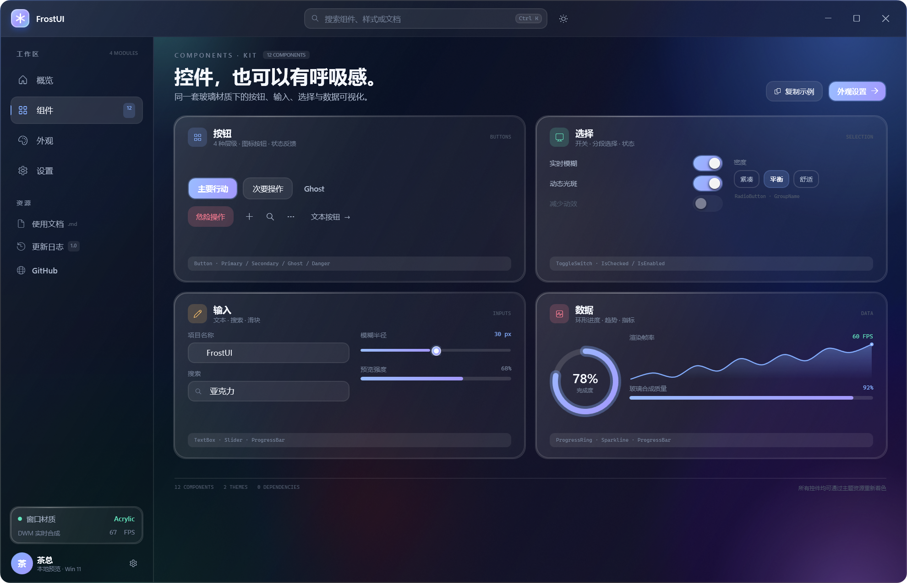
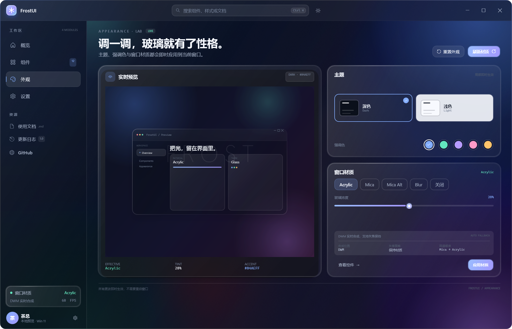
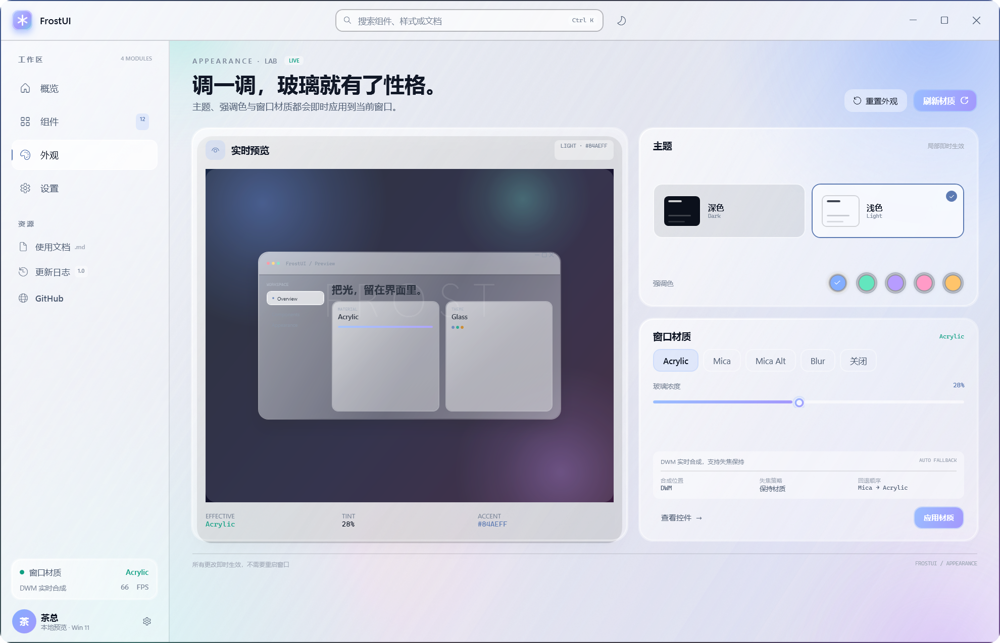
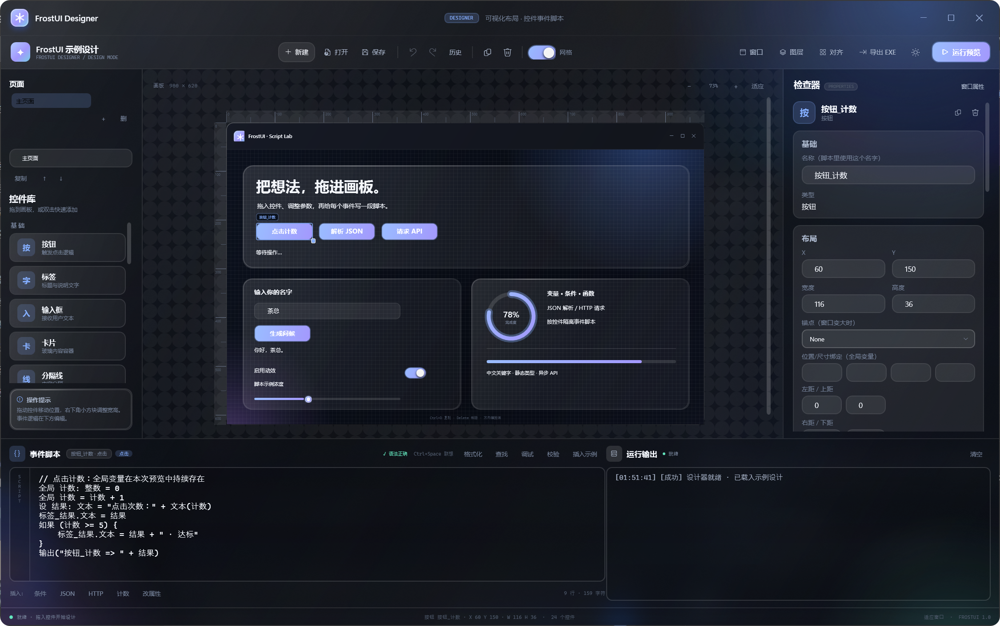
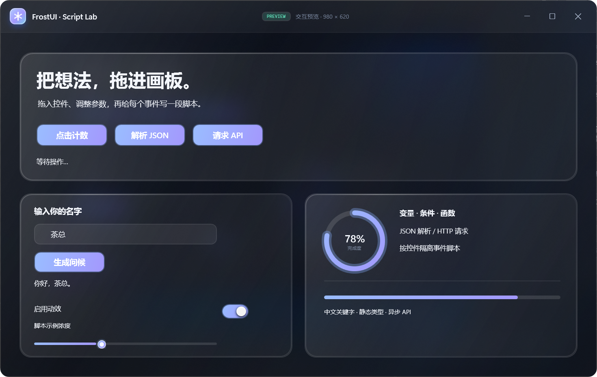
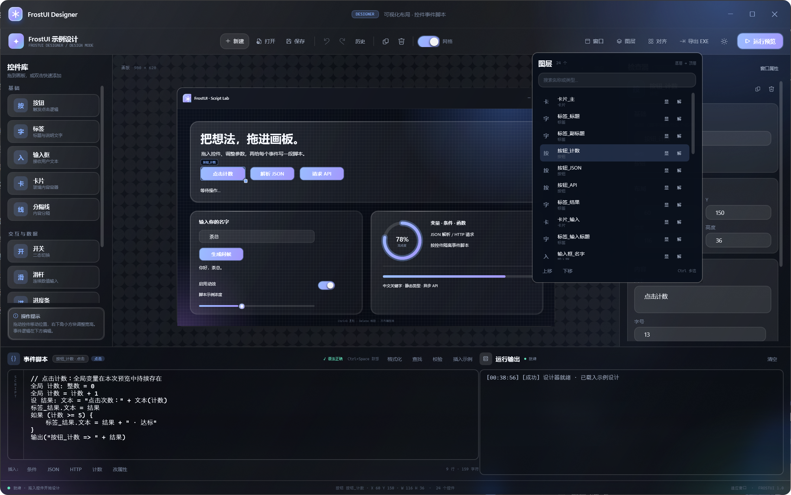

# FrostUI

> 涓€涓负 Windows 10 / 11 鎵撻€犵殑 WPF 姣涚幓鐠?UI 妗嗘灦銆傜湡瀹?DWM 浜氬厠鍔涖€佷簯姣嶆潗璐ㄣ€佸渾瑙掓棤杈规绐楀彛銆佸弻涓婚涓庝竴缁勫彲澶嶇敤鐜荤拑鎺т欢銆?>
> 鏂版墜涓婅矾锛歔闆跺熀纭€椤甸潰璁捐涓庝氦浜掕鏄庝功](FrostUI-Designer-闆跺熀纭€璇存槑涔?docx)


## 涓轰粈涔堟槸 WPF

褰撳墠鏈哄櫒鐜锛?
| 椤圭洰 | 瀹為檯鍊?|
| --- | --- |
| 鎿嶄綔绯荤粺 | Windows 11 路 Build 26200 |
| .NET SDK | 9.0.102 |
| 妗岄潰杩愯鏃?| Microsoft.WindowsDesktop.App 9.0.1 / 10.0.10 |
| 鏄剧ず鐜 | 2560 脳 1600 @ 150% DPI |
| DWM 鍚堟垚 | 宸插惎鐢?|
| 绗笁鏂逛緷璧?| 鏃?|

鐜閲屾病鏈夊畨瑁?WinUI 3 / Windows App SDK 宸ヤ綔璐熻浇锛屼絾鏈夊畬鏁寸殑 .NET 9 + WPF銆侳rostUI 鍥犳閫夋嫨 WPF锛屽苟閫氳繃 `Dwmapi.dll` / `User32.dll` 鐩存帴璋冪敤 Windows 鍚堟垚鍣細

- 涓嶉渶瑕侀澶?NuGet 鍖咃紱
- 鍗曚釜 `dotnet build` 灏辫兘缂栬瘧锛?- Acrylic / Mica 鐢?DWM 鐪熸鍚堟垚锛屼笉鏄彁鍓嶆ā绯婂ソ鐨勬埅鍥撅紱
- 鍚屼竴濂椾唬鐮佸彲浠ュ洖閫€鍒?Windows 10 鐨?Blur / Acrylic銆?
## 鐗规€?
- **鐪熷疄绐楀彛鏉愯川**锛欰crylic锛堝疄鏃舵ā绯婄獥鍙ｈ儗鍚庣殑鍐呭锛夈€丮ica / Mica Alt锛圵indows 11 澹佺焊閲囨牱锛夈€丅lur锛堝吋瀹规€фā绯婏級銆丯one锛堝唴缃洖閫€琛ㄩ潰锛夈€?- **鏃犺竟妗嗙幓鐠冪獥鍙?*锛歚FrostWindow` 鍐呯疆鍦嗚銆佹繁鑹?娴呰壊 DWM 鏍囬鏍忋€佹嫋鍔ㄣ€佸弻鍑绘渶澶у寲銆佹渶灏忓寲/杩樺師/鍏抽棴涓庤嚜瀹氫箟鏍囬鏍忓唴瀹广€?- **鐜荤拑鏉愯川浣撶郴**锛歚GlassCard` 鐨勬笎鍙樼幓鐠冨～鍏呫€佺粏楂樺厜杈圭紭銆佺敓鎴愬紡鍣偣涓庡彲閫夌幆澧冮槾褰便€?- **鍙鐢ㄦ帶浠?*锛歅rimary / Secondary / Ghost / Danger / Icon 鎸夐挳銆佹枃鏈銆佹悳绱㈡銆佹粦鏉嗐€佽繘搴︽潯銆佸崟閫夎嵂涓搞€佸鑸垪琛ㄣ€佽嚜瀹氫箟婊氬姩鏉°€佸紑鍏炽€佺幆褰㈣繘搴︺€佽糠浣犺秼鍔垮浘銆?- **鍙屼富棰?+ 杩愯鏃跺己璋冭壊**锛氬垏鎹富棰樹細鍚屾鏇挎崲鏁村棰滆壊浠ょ墝锛涘己璋冭壊浼氬疄鏃堕噸寤烘寜閽€佸紑鍏炽€佸浘琛ㄣ€佺劍鐐规弿杈圭瓑鐢诲埛銆?- **绀轰緥鍗虫枃妗?*锛氭瑙堛€佺粍浠躲€佸瑙傘€佽缃洓涓〉闈紝鍖呭惈瀹炴椂 FPS/鍐呭瓨銆佹悳绱€乀oast銆佹潗璐ㄥ垏鎹㈠拰鎴浘妯″紡銆?- **鍙鍖栬璁″櫒**锛氱嫭绔嬮」鐩?`FrostUI.Designer`锛屾敮鎸佹嫋鎺т欢銆佸睘鎬х紪杈戙€佺獥鍙ｈ缃€佹寜鎺т欢缂栧啓绫绘槗璇█浜嬩欢鑴氭湰锛屽苟鐩存帴杩愯鎴愮湡瀹炵殑 FrostUI 棰勮绐楀彛銆?- **IDE 寮忚剼鏈仈鎯?+ 瀵煎嚭 EXE**锛氳剼鏈紪杈戝櫒浼氳仈鎯虫帶浠跺悕銆佹帶浠跺睘鎬с€丣SON/HTTP 鏂规硶鍜岀被鍨嬶紱璁捐瀹屾垚鍚庡彲涓€閿彂甯冩垚甯?`FrostUI.Player.exe` 鐨勫彲杩愯 release銆?- **璁捐鍣ㄦ晥鐜囧伐鍏?*锛氭挙閿€/閲嶅仛銆佸巻鍙插揩鐓с€佽嚜鍔ㄤ繚瀛?鎭㈠銆佸閫変笌妗嗛€夈€佸榻愬垎甯冦€佹櫤鑳藉弬鑰冪嚎銆佸浘灞傛悳绱?鏄鹃殣/閿佸畾/z-order銆?- **闆跺弽灏勫紡榄旀硶**锛氭帶浠躲€佷富棰樸€佺獥鍙?API 閮芥槸鏅€?WPF 浠ｇ爜锛屽鏄撴敼銆佸鏄撲簩娆″皝瑁呫€?
## 蹇€熷紑濮?
```powershell
cd frost-ui
dotnet build FrostUI.sln -c Release
dotnet run --project samples/FrostUI.Demo/FrostUI.Demo.csproj

# 鍙鍖栬璁″櫒
dotnet run --project designer/FrostUI.Designer/FrostUI.Designer.csproj
```

鎴栬€呮墽琛屾牴鐩綍鐨?`run-demo.cmd` / `run-designer.cmd`銆?
> 鐩存帴杩愯 `bin` 涓嬬殑鏈鍚?`FrostUI.Demo.exe` 鏃讹紝Windows SmartScreen 鍙兘鎻愮ず鈥滄棤娉曡瘑鍒殑搴旂敤鈥濄€傝繖鏄彲鎵ц鏂囦欢鏈鍚嶅鑷寸殑绯荤粺琛屼负锛屼笉鏄鏋堕棶棰橈紱閫夋嫨鈥滀粛瑕佽繍琛屸€濓紝鎴栦娇鐢?`dotnet run` / `run-demo.cmd` 鍚姩鍗冲彲銆?
### 鎴浘

| 姒傝 路 娣辫壊 | 缁勪欢搴?|
| --- | --- |
|  |  |

| 澶栬瀹為獙瀹?| 娴呰壊涓婚 |
| --- | --- |
|  |  |

| 娴呰壊澶栬 | 璁剧疆涓庤瘖鏂?|
| --- | --- |
|  |  |

> 鎴浘妯″紡浼氬湪绐楀彛鑳屽悗涓存椂鎵撳紑涓€寮犳紨绀哄绾革紝璁?Acrylic 鏈夊唴瀹瑰彲浠ラ噰鏍枫€傛甯稿惎鍔ㄦ椂浼氱洿鎺ュ彔鍦ㄤ綘鐨勬闈?鍏朵粬绐楀彛涓娿€備娇鐢?`--no-showcase` 鍙互鍏抽棴婕旂ず澹佺焊銆?
## FrostUI Designer

鐙珛鐨勮璁″櫒椤圭洰浣嶄簬 `designer/FrostUI.Designer`锛岃瑙?[Designer README](../designer/README.md) 鍜?[鍔熻兘璺嚎鍥綸(designer/ROADMAP.md)銆?
- 宸︿晶鎺т欢搴撴嫋鍒扮敾鏉匡紝鎴栧弻鍑绘坊鍔狅紱鍖呭惈鎸夐挳銆佹爣绛俱€佽緭鍏ユ銆佸垪琛ㄣ€佸崱鐗囥€佸彲瑁佸垏鍥剧墖銆佸紑鍏炽€佹粦鏉嗐€佽繘搴︽潯銆佺幆褰㈣繘搴︾瓑锛屽苟鏀寔娣″叆/涓婃粦/缂╂斁涓庢椂闀?寤惰繜閰嶇疆锛?- 鍙充晶妫€鏌ュ櫒淇敼鎺т欢鍚嶇О銆佷綅缃€佸楂樸€佹枃鏈€佸瓧鍙?瀛椾綋銆佸€笺€佸彲瑙佹€э紝浠ュ強绐楀彛鏍囬/瀹介珮/鏉愯川锛涙枃鏈?鍥剧墖/鍙鎬?绐楀彛鏍囬鍙粦瀹氳剼鏈叏灞€鍙橀噺锛屼簨浠跺悗鑷姩鍒锋柊锛涘乏渚х粍浠跺簱鍙繚瀛橀€変腑鎺т欢涓哄彲澶嶇敤鐗囨锛?- 搴曢儴鎸夋帶浠跺拰浜嬩欢缂栧啓鑴氭湰锛坄鐐瑰嚮`銆乣鍒囨崲`銆乣鏂囨湰鏀瑰彉`銆乣鍊兼敼鍙榒銆佺獥鍙?`鍚姩`锛夛紱
- 鑴氭湰鏀寔涓枃鍏抽敭瀛椼€佹潯浠躲€佸惊鐜?閬嶅巻銆佸嚱鏁?杩斿洖銆佸垪琛ㄣ€丣SON 瑙ｆ瀽銆丠TTP GET/POST銆佹帶浠跺睘鎬ц鍐欙紱
- 杈撳叆鎺т欢鍚嶅悗 `.` 浼氭彁绀鸿鎺т欢鐨勫睘鎬э紝`JSON.` / `HTTP.` 浼氭彁绀哄搴旀柟娉曪紱`Ctrl+Space` 涓诲姩鑱旀兂锛?- 鏀寔鎾ら攢/閲嶅仛銆佸巻鍙茶烦杞€佽嚜鍔ㄤ繚瀛樻仮澶嶃€佸閫?妗嗛€夈€佸榻愬垎甯冦€佹櫤鑳藉弬鑰冪嚎銆佸浘灞傛樉闅?閿佸畾/鎼滅储锛?- 鑴氭湰缂栬緫鍖烘彁渚涘彲鎼滅储/缃《鐨勫嚱鏁颁笌鎺т欢鍙傝€冪獥鍙ｏ紝鍙屽嚮鍙彃鍏ョ鍚嶏紱閫夋嫨妗嗗拰娑堟伅寮圭獥缁熶竴浣跨敤 FrostUI 涓婚妯℃澘锛岃窡闅忔繁/娴呰壊鍒囨崲锛涙帶浠舵敮鎸佸叧閿抚鍔ㄧ敾鏃堕棿绾匡紝椤甸潰鏀寔杩涘叆杞満锛?- 鐢诲竷鏀寔閫傚簲缂╂斁銆乣Ctrl+婊氳疆` 缂╂斁銆佷腑閿钩绉汇€佽嚜瀹氫箟缃戞牸銆佹爣灏恒€佸弬鑰冪嚎鎷栧姩/鍒犻櫎鍜屽惛闄勶紱绐楀彛鍙紑鍚唴瀹规暣浣撶缉鏀俱€佹帶浠剁骇鍥涘悜閿氱偣/鎷変几/杈硅窛銆佸搷搴斿紡鏂偣锛屽苟浣跨敤 Stack/Grid/Dock/Scroll 瀹瑰櫒閲嶆帓瀛愭帶浠讹紱鏀寔澶氶〉闈€佺嫭绔嬬獥鍙?妯℃€佸脊绐楀拰鎺т欢/鑴氭湰瀵艰埅锛涜剼鏈紪杈戝櫒鎻愪緵瀹炴椂璇婃柇銆侀棶棰樺垪琛ㄣ€佹湭鐭ユ帶浠?灞炴€ф鏌ャ€佸熀纭€绫诲瀷妫€鏌ャ€侀敊璇尝娴嚎銆佹嫭鍙烽珮浜€佹煡鎵炬浛鎹€佹敞閲娿€佸弬鏁版彁绀恒€佹偓娴枃妗ｃ€佽嚜鍔ㄦ牸寮忓寲锛屼互鍙?F9 鏂偣/鏆傚仠/鍗曟/鍙橀噺/璋冪敤鏍堣皟璇曪紱`Ctrl+K` 鍙墦寮€鍛戒护闈㈡澘锛?- `F5` 鎵撳紑鐪熷疄 FrostUI 棰勮绐楀彛锛岃剼鏈搷浣滅殑鏄璁℃枃浠剁殑娣辨嫹璐濓紝涓嶄細姹℃煋璁捐绋匡紱
- **瀵煎嚭 EXE** 鍙戝竷 `FrostUI.Player.exe` + 渚濊禆 + `design.frostui.json`锛屾敮鎸佽嚜鍖呭惈/妗嗘灦渚濊禆銆佸崟鏂囦欢銆丷eadyToRun銆佺増鏈?鍏徃/EXE 鍥炬爣銆佸畨瑁?鍗歌浇鑴氭湰銆両nno Setup 妯℃澘鍜岀鍚嶈鏄庯紱
- 鏀寔 `.frostui.json` 淇濆瓨/鎵撳紑銆?
| 浜嬩欢鑴氭湰 | 鐪熷疄棰勮 |
| --- | --- |
|  |  |

鍥惧眰銆侀攣瀹氥€佹樉闅愪笌 z-order锛?


## 鍦ㄩ」鐩腑浣跨敤

### 1. 寮曠敤绫诲簱

```xml
<ItemGroup>
  <ProjectReference Include="..\src\FrostUI\FrostUI.csproj" />
</ItemGroup>
```

鐩爣妗嗘灦浣跨敤 `net9.0-windows`锛堟垨鏇撮珮鐗堟湰鐨?WindowsDesktop SDK锛夛紝骞跺紑鍚?WPF锛?
```xml
<TargetFramework>net9.0-windows</TargetFramework>
<UseWPF>true</UseWPF>
```

### 2. 鍚堝苟涓婚璧勬簮

```xml
<Application.Resources>
  <ResourceDictionary>
    <ResourceDictionary.MergedDictionaries>
      <ResourceDictionary Source="pack://application:,,,/FrostUI;component/Themes/Colors.Dark.xaml" />
      <ResourceDictionary Source="pack://application:,,,/FrostUI;component/Themes/Controls.xaml" />
    </ResourceDictionary.MergedDictionaries>
  </ResourceDictionary>
</Application.Resources>
```

闇€瑕佹祬鑹蹭富棰樻椂锛屾妸 `Colors.Dark.xaml` 鎹㈡垚 `Colors.Light.xaml`銆備袱涓鑹插瓧鍏搁兘鍖呭惈 `Accent*`銆乣Text*`銆乣Card*`銆乣TitleBar*` 绛夊畬鏁翠护鐗岋紝`Controls.xaml` 涓嶅寘鍚鑹诧紝鍙寘鍚牱寮忥紝鎵€浠ュ彲浠ョ嫭绔嬪鐢ㄣ€?
### 3. 鍒涘缓鐜荤拑绐楀彛

```xml
<ui:FrostWindow x:Class="MyApp.MainWindow"
                xmlns="http://schemas.microsoft.com/winfx/2006/xaml/presentation"
                xmlns:x="http://schemas.microsoft.com/winfx/2006/xaml"
                xmlns:ui="clr-namespace:FrostUI.Controls;assembly=FrostUI"
                Title="My App"
                Width="1200" Height="800"
                WindowStartupLocation="CenterScreen"
                Style="{StaticResource FrostWindowStyle}"
                Backdrop="Acrylic"
                TintOpacity="0.28">

    <ui:FrostWindow.TitleBarContent>
        <TextBlock Text="鎴戠殑鐜荤拑搴旂敤"
                   Foreground="{DynamicResource TextSecondaryBrush}" />
    </ui:FrostWindow.TitleBarContent>

    <Grid Margin="24">
        <ui:GlassCard CornerRadius="18" Padding="20">
            <StackPanel>
                <TextBlock Text="Hello, glass."
                           Style="{StaticResource SectionTitleTextStyle}" />
                <Button Content="Primary action"
                        Style="{StaticResource PrimaryButtonStyle}"
                        Margin="0,14,0,0" />
            </StackPanel>
        </ui:GlassCard>
    </Grid>
</ui:FrostWindow>
```

`FrostWindow` 浼氬湪鏋勯€犲嚱鏁伴噷璁剧疆锛?
- `WindowStyle=None`
- `AllowsTransparency=false`锛堝繀椤伙紝鍚﹀垯 DWM 鏉愯川浼氳鍒嗗眰绐楀彛鐮村潖锛?- `WindowChrome.CaptionHeight = TitleBarHeight`
- `CompositionTarget.BackgroundColor = Transparent`
- 鑷畾涔夋爣棰樻爮銆佸渾瑙掑拰 DWM 娣辫壊妯″紡

涓嶈鍦ㄤ笟鍔?XAML 閲岃鐩栬繖浜涚獥鍙ｈ缃紱鍙缃?`Backdrop`銆乣TintOpacity` 鍜屾爣棰樻爮鍐呭鍗冲彲銆?
### 4. 甯哥敤鎺т欢

```xml
<!-- 鍗＄墖锛氫氦浜掓€?/ 闃村奖 / 寮鸿皟鑹插厜鏅?-->
<ui:GlassCard CornerRadius="16" Padding="18"
              IsInteractive="True" HasShadow="True" Glow="True">
    <TextBlock Text="frosted surface" />
</ui:GlassCard>

<!-- 寮€鍏?-->
<ui:GlassToggleSwitch IsChecked="True" />

<!-- 鐜舰杩涘害 -->
<ui:ProgressRing Value="72" StrokeThickness="8"
                 TrackBrush="{DynamicResource InsetSurfaceStrongBrush}"
                 ProgressBrush="{DynamicResource AccentGradientBrush}"
                 GlowBrush="{DynamicResource AccentGlowBrush}" />

<!-- 杩蜂綘瓒嬪娍鍥?-->
<ui:Sparkline Height="48"
              Values="42,48,44,55,50,62,56,66,60,72"
              Stroke="{DynamicResource AccentBrush}"
              StrokeThickness="1.6" />
```

**鎸夐挳 / 杈撳叆 / 閫夋嫨鏍峰紡閿?*

| Key | 鐢ㄩ€?|
| --- | --- |
| `PrimaryButtonStyle` | 寮鸿皟鑹叉笎鍙樹富鎸夐挳 |
| `SecondaryButtonStyle` | 鐜荤拑娆＄骇鎸夐挳 |
| `GhostButtonStyle` | 鏃犲簳鑹叉枃鏈?鍥炬爣鎸夐挳 |
| `DangerButtonStyle` | 鍗遍櫓鎿嶄綔 |
| `IconButtonStyle` | 30脳30 鍥炬爣鎸夐挳 |
| `GlassTextBoxStyle` | 鐜荤拑鏂囨湰妗?|
| `SearchTextBoxStyle` | 鏃犺竟妗嗘悳绱㈣緭鍏?|
| `GlassSliderStyle` | 寮鸿皟鑹叉粦鏉?|
| `GlassProgressBarStyle` | 寮鸿皟鑹茶繘搴︽潯 |
| `GlassRadioButtonStyle` | 鍒嗘閫夋嫨鑽父 |
| `NavListBoxStyle` / `NavListBoxItemStyle` | 渚ц竟瀵艰埅 |

### 5. 涓婚涓庡己璋冭壊

```csharp
using FrostUI.Theme;

ThemeManager.Initialize();

// 娣辫壊 / 娴呰壊
ThemeManager.SetTheme(FrostThemeMode.Light);
ThemeManager.ToggleTheme();

// 棰勮寮鸿皟鑹诧細鍐板窛钃濄€佽杽鑽烽潚銆佹毊鍏夌传銆侀湠鍏夌矇銆佺惀鐝€閲?ThemeManager.SetAccent(ThemeManager.Presets[1].Color);

// 鑷畾涔夐鑹?ThemeManager.SetAccent(Color.FromRgb(0x84, 0xAE, 0xFF));
```

> 涓婚鏋氫妇鍙?`FrostThemeMode`锛岃€屼笉鏄?`ThemeMode`锛屾槸涓轰簡閬垮紑鏂扮増 WPF 鑷甫鐨?`System.Windows.ThemeMode` 閲嶅悕銆?
`ThemeManager` 浼氾細

1. 鎵惧埌宸插悎骞剁殑 `Colors.Dark.xaml` / `Colors.Light.xaml` 骞舵浛鎹紱
2. 鍦?`Application.Resources` 鏍瑰眰閲嶅缓 `AccentBrush`銆乣AccentGradientBrush`銆乣AccentSoftBrush`銆乣AccentGlowBrush` 绛夌敾鍒凤紱
3. 瑙﹀彂 `ThemeChanged` / `AccentChanged`锛?4. 閫氱煡 `FrostWindow` 閲嶆柊搴旂敤 DWM 娣辫壊妯″紡涓庣獥鍙?tint銆?
## 鏉愯川鏀寔

| `Backdrop` | Windows 10 1809+ | Windows 11 21H2 | Windows 11 22H2+ | 璇存槑 |
| --- | --- | --- | --- | --- |
| `Acrylic` | 鉁咃紙SWCA锛?| 鉁咃紙SWCA锛?| 鉁咃紙SWCA锛?| 瀹炴椂妯＄硦绐楀彛鍚庢柟鍐呭锛屾敮鎸?tint |
| `Blur` | 鉁?| 鉁?| 鉁?| 鏃х増妯＄硦锛屾棤棰滆壊鍙犲姞 |
| `Mica` | 鍥為€€ Acrylic | 鍥為€€ Acrylic | 鉁咃紙DWM 38锛?| 閲囨牱妗岄潰澹佺焊锛屼笉閲囨牱鑳屽悗绐楀彛 |
| `MicaAlt` | 鍥為€€ Acrylic | 鍥為€€ Acrylic | 鉁咃紙DWM 38锛?| 瀵规瘮搴︽洿楂樼殑 Mica 鍙樹綋 |
| `None` | 鉁?| 鉁?| 鉁?| 鍏抽棴绯荤粺鏉愯川锛屼娇鐢ㄥ唴缃洖閫€琛ㄩ潰 |

FrostUI 鍦?Windows 11 涓婂 Acrylic 缁х画浣跨敤 `SetWindowCompositionAttribute`锛屽洜涓哄畠鍙互绋冲畾鍦扮粰鏁寸獥鍙犲姞 tint锛屽苟涓斾笉浼氬洜绐楀彛澶辩劍鑰屾秷澶憋紱Mica 浣跨敤 `DwmSetWindowAttribute(DWMWA_SYSTEMBACKDROP_TYPE)` + `DwmExtendFrameIntoClientArea`銆傚鏋?DWM 鍚堟垚琚鐢ㄣ€丄PI 杩斿洖澶辫触锛屾垨鑰呯郴缁熺増鏈笉澶燂紝浼氭寜涓婅〃鑷姩鍥為€€銆?
> `TintOpacity` 鍙奖鍝?Acrylic 鐨勫師鐢?tint銆侻ica 鐨勯鑹茬敱 Windows 涓婚鍜屽绾稿喅瀹氾紝Blur / None 涓嶄娇鐢ㄨ tint锛涜繖涔熸槸绀轰緥涓垏鎹?Mica 鍚庢粦鏉嗕粛淇濈暀銆佷絾瑙嗚鐢?DWM 鎺у埗鐨勫師鍥犮€?
鍒囨崲鏉愯川锛?
```xml
<ui:FrostWindow Backdrop="Mica" />
```

鎴栬繍琛屾椂锛?
```csharp
window.Backdrop = WindowBackdrop.Acrylic;
window.TintOpacity = 0.36;
window.RefreshBackdrop();
```

## 绀轰緥绋嬪簭

绀轰緥浣嶄簬 `samples/FrostUI.Demo`锛屽惎鍔ㄥ悗鍖呭惈鍥涗釜椤甸潰锛?
- **姒傝**锛欻ero 灞曠ず銆佸疄鏃?FPS/鍐呭瓨銆佹潗璐ㄦ祿搴︺€佺郴缁熸潗璐ㄥ紑鍏炽€佸己璋冭壊銆佷富棰樹笌鏉愯川鍒囨崲銆?- **缁勪欢**锛氭寜閽€佽緭鍏ャ€侀€夋嫨銆佹粦鏉嗐€佽繘搴︺€佺幆褰㈣繘搴︺€佽秼鍔垮浘銆乀oast銆?- **澶栬**锛氬疄鏃堕瑙堛€佷富棰樺崱鐗囥€佸己璋冭壊銆佷簲绉嶇獥鍙ｆ潗璐ㄤ笌鐜荤拑娴撳害銆?- **璁剧疆**锛氳繍琛岀幆澧冦€丏WM 璇婃柇銆佸揩鎹烽敭銆佽瘖鏂俊鎭鍒躲€?
蹇嵎閿細

| 蹇嵎閿?| 琛屼负 |
| --- | --- |
| `Ctrl + K` | 鑱氱劍鏍囬鏍忔悳绱?|
| `Ctrl + Shift + T` | 鍒囨崲娣辫壊 / 娴呰壊涓婚 |
| `Esc` | 娓呯┖鎼滅储骞跺彇娑堢劍鐐?|
| `Alt + F4` | 鍏抽棴绐楀彛 |

### 鎴浘 / 鏃犲ご楠岃瘉鍙傛暟

```powershell
dotnet run --project samples/FrostUI.Demo/FrostUI.Demo.csproj -- `
  --screenshot screenshots/overview.png `
  --page overview `
  --light `
  --accent "#63E6BE" `
  --backdrop Acrylic
```

鍙敤鍙傛暟锛?
- `--screenshot <path>`锛氭埅鍥惧埌 PNG 鍚庤嚜鍔ㄩ€€鍑恒€?- `--page overview|components|appearance|settings`锛氬惎鍔ㄩ〉銆?- `--light`锛氫互娴呰壊涓婚鍚姩銆?- `--accent #RRGGBB`锛氬惎鍔ㄥ己璋冭壊銆?- `--backdrop Acrylic|Mica|MicaAlt|Blur|None`锛氬惎鍔ㄦ潗璐ㄣ€?- `--no-showcase`锛氭埅鍥炬椂涓嶅啀鎵撳紑婕旂ず澹佺焊锛岀洿鎺ュ彔鍦ㄥ疄闄呮闈笂銆?
鏍圭洰褰曠殑 `capture-screenshots.cmd` 鍙互涓€娆℃€ч噸寤哄苟鐢熸垚鏁村灞曠ず鍥撅紙PowerShell 鑴氭湰鍙楁墽琛岀瓥鐣ラ檺鍒舵椂锛宍.cmd` 浼氫互 `Bypass` 杩愯锛夈€?
## 椤圭洰缁撴瀯

```
frost-ui/
鈹溾攢 src/FrostUI/
鈹? 鈹溾攢 Controls/
鈹? 鈹? 鈹溾攢 FrostWindow.cs          # 鏃犺竟妗嗙幓鐠冪獥鍙?+ DWM 浜掓搷浣?鈹? 鈹? 鈹溾攢 GlassCard.cs            # 鍗＄墖鍐呭鎺т欢
鈹? 鈹? 鈹溾攢 GlassToggleSwitch.cs
鈹? 鈹? 鈹溾攢 ProgressRing.cs
鈹? 鈹? 鈹斺攢 Sparkline.cs
鈹? 鈹溾攢 Interop/
鈹? 鈹? 鈹溾攢 NativeMethods.cs
鈹? 鈹? 鈹斺攢 WindowBackdrop.cs
鈹? 鈹溾攢 Media/FrostMaterials.cs    # 鐢熸垚寮忓櫔鐐圭汗鐞?鈹? 鈹溾攢 Theme/
鈹? 鈹? 鈹溾攢 ThemeManager.cs
鈹? 鈹? 鈹溾攢 FrostThemeMode.cs
鈹? 鈹? 鈹斺攢 ColorUtil.cs
鈹? 鈹斺攢 Themes/
鈹?    鈹溾攢 Colors.Dark.xaml
鈹?    鈹溾攢 Colors.Light.xaml
鈹?    鈹斺攢 Controls.xaml
鈹溾攢 samples/FrostUI.Demo/
鈹? 鈹溾攢 MainWindow.xaml
鈹? 鈹溾攢 Views/                    # 姒傝銆佺粍浠躲€佸瑙傘€佽缃?鈹? 鈹溾攢 Services/                 # 瀹炴椂鎸囨爣銆佹埅鍥?鈹? 鈹斺攢 ShowcaseBackdropWindow.xaml
鈹溾攢 designer/FrostUI.Designer/
鈹? 鈹溾攢 Models/                   # 璁捐鏂囨。銆佹帶浠躲€佺洰褰曘€佽仈鎯抽」
鈹? 鈹溾攢 Scripting/                # 绫绘槗璇█鑴氭湰寮曟搸
鈹? 鈹溾攢 Services/                 # 搴忓垪鍖栥€侀瑙堟帶浠跺伐鍘傘€佽仈鎯炽€佸鍑恒€佽嚜娴?鈹? 鈹溾攢 Views/                    # PreviewWindow銆丒xportDialog
鈹? 鈹溾攢 samples/                  # 鍙洿鎺ユ墦寮€鐨勭ず渚嬭璁?鈹? 鈹斺攢 MainWindow.xaml           # 宸ュ叿绠?/ 鐢绘澘 / 妫€鏌ュ櫒 / 鑴氭湰 / 杈撳嚭
鈹溾攢 player/FrostUI.Player/
鈹? 鈹溾攢 App.xaml                  # 鍔犺浇 design.frostui.json
鈹? 鈹斺攢 FrostUI.Player.csproj     # 瀵煎嚭 release 鐨勮繍琛屽涓?鈹溾攢 screenshots/
鈹溾攢 docs/architecture.md
鈹溾攢 README.md
鈹斺攢 LICENSE
```

## 璁捐璇存槑涓庨檺鍒?
- **Acrylic 鏄暣绐楁潗璐?*銆侱WM 鍙礋璐ｇ獥鍙ｈ儗鍚庡尯鍩熺殑鍚堟垚锛屼笉鑳界粰姣忎釜 WPF 鎺т欢鍗曠嫭閲囨牱妗岄潰銆俙GlassCard` 鐢ㄥ崐閫忔槑娓愬彉 + 鍣偣 + 缁嗚竟楂樺厜鏉ユā鎷熺幓鐠冪殑鍒嗗眰锛岃繖鏃㈣交閲忓張鍙帶銆?- **Mica 閲囨牱澹佺焊锛屼笉閲囨牱鍏跺畠绐楀彛**锛涜繖涓嶆槸 bug锛屾槸 Windows 鏉愯川鏈韩鐨勫畾涔夈€?- **蹇呴』鍦ㄦ敮鎸?DWM 鍚堟垚鐨?Windows 涓婅繍琛?*銆俁DP銆佽櫄鎷熸満鎴栧叧闂€忔槑鏁堟灉鏃讹紝Acrylic 鍙兘闄嶇骇涓?Blur 鎴?None锛涙鏋朵細淇濇寔娴呰壊/娣辫壊鍥為€€琛ㄩ潰鍙敤銆?- **涓嶈寮€鍚?`AllowsTransparency=true`**锛氫細鐮村潖 `FrostWindow` 鐨?DWM 鏉愯川璺緞銆傞渶瑕佸紓褰?瀹屽叏閫忔槑绐楀彛鏃惰鍙﹀缓绐楀彛绫诲瀷銆?- 鎺т欢澶ч噺浣跨敤鍗婇€忔槑鐢诲埛涓?`DropShadowEffect`锛涘鏋滅洰鏍囨満鍣ㄦ€ц兘杈冨急锛屽噺灏?`HasShadow` / `Glow` 鐨勪娇鐢ㄥ嵆鍙€傜獥鍙ｆ湰韬病鏈夊父椹荤灞忎綅鍥俱€?- 褰撳墠绀轰緥涓庣綉鏍煎竷灞€閽堝 1280脳850锛?50% 缂╂斁锛夎皟浼橈紱鏇村皬鐨勫睆骞曚細鑷姩缂╁皬绐楀彛锛岄〉闈㈠唴浣跨敤 `ScrollViewer`锛屼絾 1100脳720 浠ヤ笅鐨勭┖闂翠細姣旇緝绱у噾銆?
## 宸查獙璇佺幆澧?
- Windows 11 Build 26200锛?50% DPI锛?560脳1600锛?- .NET SDK 9.0.102
- WindowsDesktop 9.0.1 / 10.0.10
- Acrylic锛圫WCA锛夊疄闄呯敓鏁?- Mica锛圖WM锛夊疄闄呯敓鏁?- 娣辫壊 / 娴呰壊涓婚杩愯鏃跺垏鎹?- 浜旂鏉愯川鍏ュ彛涓庤嚜鍔ㄥ洖閫€璺緞
- Designer 鑷祴锛氱被鍨嬨€佹潯浠躲€佸叏灞€鍙橀噺銆丣SON銆丠TTP銆佺ず渚嬭剼鏈€佸簭鍒楀寲寰€杩斻€両DE 鑱旀兂銆佸巻鍙叉挙閿€/閲嶅仛
- 璁捐鍣ㄤ氦浜掞細澶氶€?妗嗛€夈€佸榻愩€佸浘灞傛悳绱?鏄鹃殣/閿佸畾銆佸巻鍙茶烦杞€佽嚜鍔ㄤ繚瀛樸€佺缉鏀?骞崇Щ銆佸疄鏃惰娉曡瘖鏂?- 瀵煎嚭娴嬭瘯锛氭鏋朵緷璧?/ 鑷寘鍚?release 鍧囧彂甯冩垚鍔燂紝瀵煎嚭鐨?`FrostUI.Player.exe` 鍙洿鎺ヨ繍琛屽苟鎵ц鎸夐挳鑴氭湰
- `dotnet build FrostUI.sln`锛? warning / 0 error

## License

MIT銆傝瑙?[LICENSE](LICENSE)銆?
